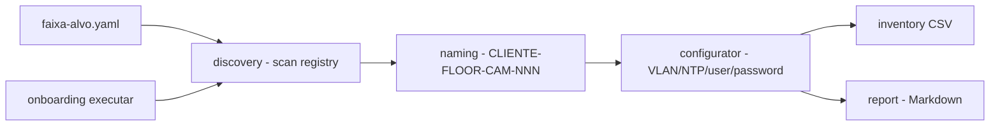

# camera-onboarding

**English** · [Português (Brasil)](README.md)

[](#) [](#) [](#) [](LICENSE)

## What it is

**Batch onboarding of IP cameras**: it discovers cameras on a local range (a simulated registry, no sockets), applies a **naming standard** (`CAM`), **configures** each device (VLAN, NTP, user and password rotation, validating RFC 1918 addresses) in an **idempotent** way and produces a **Markdown report** of the batch. It is an educational infrastructure/network-automation lab.

## Status

An educational lab, working and tested (37 tests).

## Features

- **Discovery** (`descoberta.py`): scans a local range via `REGISTRO_SIMULADO` (no sockets), validates CIDR (`faixa_valida`).
- **Naming** (`naming.py`): `CLI-<FLOOR>-CAM-NNN` pattern, with validation and next-number logic.
- **Configurator** (`configurador.py`): applies VLAN, NTP, sets the user and rotates the password on a simulated camera; validates RFC 1918 IPs.
- **Inventory** (`inventario.py`): reads a CSV with header `nome,ip,andar,usuario,senha,vlan,ntp,estado`.
- **Report** (`relatorio.py`): Markdown log with each camera's state.
- **CLI**: `onboarding executar --faixa <yaml> --inventario <csv> --log <md>`.

## Architecture

An `onboarding` package with `descoberta`, `naming`, `configurador`, `inventario` and `relatorio`, orchestrated by the CLI. The configuration is **simulated** (no real device is touched).



## Stack

- Python ≥ 3.10
- PyYAML ≥ 6.0 (only dependency)
- pytest (dev)

## Repository layout

```
camera-onboarding/
├── pyproject.toml · BRIEF.md
├── src/onboarding/
│   ├── descoberta.py · naming.py · configurador.py
│   ├── inventario.py · relatorio.py · cli.py
├── dados/
│   ├── faixa-alvo.yaml
│   └── inventario-inicial.csv   # contains fictitious user/password (FICTICIA)
├── docs/             # mass onboarding, naming standard
├── tests/            # 37 tests
└── LICENSE           # MIT
```

## Prerequisites and installation

Python ≥ 3.10.

```bash
pip install -e .
```

## How to run

```bash
onboarding executar --faixa dados/faixa-alvo.yaml --inventario dados/inventario-inicial.csv --log relatorio.md
```

## Tests and quality

Real command (verified by the agent):

```bash
PYTHONPATH=src python -m pytest tests/
# 37 passed
```

## Technical decisions and trade-offs

- **Socket-free simulation**: runs safely in any environment; in exchange, it does not perform real discovery/onboarding.
- **RFC 1918 validation** and naming standard: good practices avoid batch failures.
- **Idempotency**: reprocessing does not reconfigure twice.

## Known limitations and roadmap

- Discovery and configuration are simulated (no real camera actions).
- The sample inventory has **fictitious** user/password (`FICTICIA`) — replace with real credentials with care when adapting.
- Real application would require camera-protocol integration (e.g. ONVIF) and secure credential management.

## Development process

An individual project by Kelvin Oliveira, built with orchestrated AI agents and reviewed by the author. The onboarding flow and the review are the author's.

## License and author

MIT — Copyright (c) 2026 Kelvin Rebelo de Oliveira.

**Author**: [Kelvin Oliveira](https://github.com/KelvinOliveiraCode) · [Portfolio](https://kelvinoliveiracode.github.io/portfolio/)
