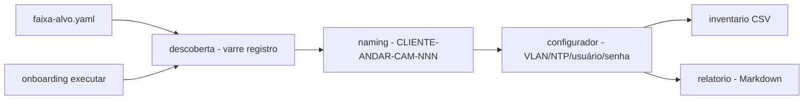

# camera-onboarding

[English](README.en.md) · **Português (Brasil)**

[](#) [](#) [](#) [](LICENSE)

## O que é

**Onboarding de câmeras IP em lote**: descobre as câmeras numa faixa local (registro simulado, sem socket), aplica um **padrão de nomenclatura** (`CAM`), **configura** cada dispositivo (VLAN, NTP, usuário e troca de senha, validando endereços RFC 1918) de forma **idempotente** e gera um **relatório Markdown** do lote. É um laboratório educacional de automação de infraestrutura/redes.

## Status

Laboratório educacional funcional e testado (37 testes).

## Funcionalidades

- **Descoberta** (`descoberta.py`): varre uma faixa local via `REGISTRO_SIMULADO` (sem abrir socket), valida CIDR (`faixa_valida`).
- **Nomenclatura** (`naming.py`): padrão `CLI-<ANDAR>-CAM-NNN`, com validação e próximo número.
- **Configurador** (`configurador.py`): aplica VLAN, NTP, define usuário e troca senha em câmera simulada; valida IP RFC1918.
- **Inventário** (`inventario.py`): lê CSV com cabeçalho `nome,ip,andar,usuario,senha,vlan,ntp,estado`.
- **Relatório** (`relatorio.py`): log Markdown com o estado de cada câmera.
- **CLI**: `onboarding executar --faixa <yaml> --inventario <csv> --log <md>`.

## Arquitetura

Pacote `onboarding` com `descoberta`, `naming`, `configurador`, `inventario` e `relatorio`, orquestrados pelo CLI. A configuração é **simulada** (sem tocar em equipamento real).



## Stack

- Python ≥ 3.10
- PyYAML ≥ 6.0 (única dependência)
- pytest (dev)

## Estrutura do repositório

```
camera-onboarding/
├── pyproject.toml · BRIEF.md
├── src/onboarding/
│   ├── descoberta.py · naming.py · configurador.py
│   ├── inventario.py · relatorio.py · cli.py
├── dados/
│   ├── faixa-alvo.yaml
│   └── inventario-inicial.csv   # contém usuário/senha fictícios (FICTICIA)
├── docs/             # onboarding em massa, padrão de nomenclatura
├── tests/            # 37 testes
└── LICENSE           # MIT
```

## Pré-requisitos e instalação

Python ≥ 3.10.

```bash
pip install -e .
```

## Como executar

```bash
onboarding executar --faixa dados/faixa-alvo.yaml --inventario dados/inventario-inicial.csv --log relatorio.md
```

## Testes e qualidade

Comando real (verificado pelo agente):

```bash
PYTHONPATH=src python -m pytest tests/
# 37 passed
```

## Decisões técnicas e trade-offs

- **Simulação sem socket**: roda em qualquer ambiente com segurança; em troca, não faz descoberta/onboarding reais de equipamento.
- **Validação RFC1918** e padrão de nomenclatura: boas práticas evitam falhas em lote.
- **Idempotência**: reprocessar não reconfigura duas vezes.

## Limitações conhecidas e roadmap

- Configuração e descoberta simuladas (não dispara ações reais em câmeras).
- O inventário de exemplo traz usuário/senha **fictícios** (`FICTICIA`) — troque por credenciais reais com cuidado se for adaptar.
- Aplicação real exigiria integração com o protocolo da câmera (ex.: ONVIF) e gestão segura de credenciais.

## Processo de desenvolvimento

Projeto individual de Kelvin Oliveira, construído com agentes de IA orquestrados e revisado pelo autor. O fluxo de onboarding e a revisão são do autor.

## Licença e autor

MIT — Copyright (c) 2026 Kelvin Rebelo de Oliveira.

**Autor**: [Kelvin Oliveira](https://github.com/KelvinOliveiraCode) · [Portfólio](https://kelvinoliveiracode.github.io/portfolio/)
